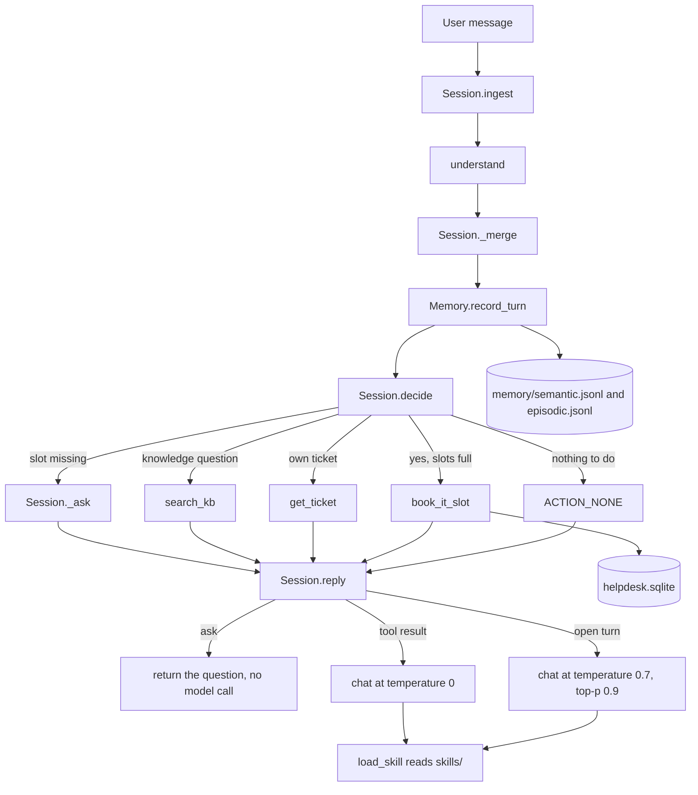

# Dialogue pipeline

`understand` labels the turn. `Session.decide` either asks for the next missing slot or calls one tool, and `book_it_slot` runs only after the user confirms. `Session.reply` reads `skills/system_prompt_v1.md` from disk, and adds `skills/book_slot_steps_v1.md` only when the turn is about a visit.
